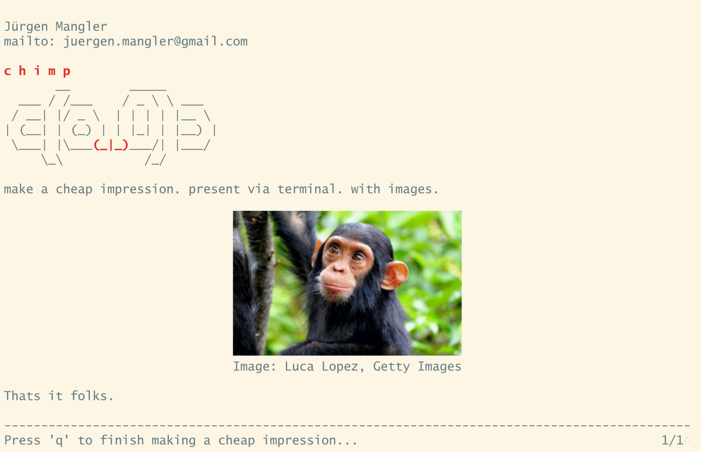

CHIMP - Cheap IMpression Presenter
==================================

           __        _____
      ___ / /___    / _ \ \ ___
     / __| |/ _ \  | | | | |__ \
    | (__| | (_) | | |_| | |__) |
     \___| |\___(_|_)____| |___/
          \_\           /_/

Make a cheap impression. Present via terminal.

```gem install cheap-impression-presenter```

The ruby gems it needs (tty-screen, pastel, hexapdf) are installed with it. Some
features need external programs, which have to be installed separately (all are
available in the usual linux distributions and homebrew):

* ``figlet``: for the figlet plugin.
* ``img2sixel`` (from libsixel): for the sixel plugin, i.e. pictures in the terminal.
  Your terminal also needs sixel support.
* ``inkscape``: for svg pictures, in the terminal as well as in the PDF output.
* DejaVu Sans Mono font: for the PDF output. If it is not installed, Courier is
  used, which lacks some characters (e.g. box drawing).

It has a simple syntax:

    #what: the title of presentation
    #size: the number of lines to zoom to (default 31, see below)
    #theme: the PDF colors, e.g. background=#fdf6e3 text=#657b83 (see below)
    #template: content drawn before anything else on the slide (e.g. ```figlet,right LOGO)
    #template:
      content drawn before anything else on the slide
    #end

    --- splits slides

    +++ slides parts to appear

    !!Bold Text!!
    ''Red Text''
    %%Blue Text%%
    ~~Center Text
    ~~Center Text with !!Bold!!, ''Red'' and %%Blue%%

Plugins can not be used in centered lines, they have
their own center parameter.

Everything else is in plugins. The following plugins are existing for now:

* Sixel: display graphics in the terminal: `` ```sixel,20 name.png``.
  * The parameter 20 denotes the size in characters.
  * You can add right or center as an additional parameter to align the picture.
  * If the picture is right aligned and float is added as an additional parameter, text is added on the left of the picture instead of beneath.
  * You can add animate as an additional parameter to return the cursor to where the picture started. Text that follows is then added on top of the picture instead of beneath. Combined with +++ the next picture replaces the current one, which allows for simple animations (see examples/sixel_svg.2.txt).
* Figlet: display fancy ascii text: `` ```figlet FANCY_TEXT``.
  * You can add right or center as a parameter to align the fancy text.
  * If the fancy text is right aligned, normal text is added on the left of the fancy text instead of beneath.
* Line Numbers: display line numbers beforce any text (mostly used for code :-).
~~~text
```lnums
Line
Line
Line
```
~~~

Templates should be positioned carefully (e.g. right aligned figlet or sixel) to
not collide with the content. All header lines (#what, #size, #theme, #template)
have to be at the very beginning of the presentation.

Run the presentation with:

```bash
chimp mypresentation.txt
```

While presenting you can use the usual button for navigating. In addition, you
can use ``q`` to quit the presentation, and ``r`` to refresh the screen. I suggest zooming
the terminal until about 30 lines are visible. To make this easy a ``^`` character is
visible at the right end of the footer line. Zoom until the ``^`` character is no longer visible for
the most audience friendly results. The ``^`` is shown as long as more than 31 lines are visible,
use ``#size:`` directly after ``#what:`` to change this number.

Check out the examples.

How does it look?
=================



History & Thanks
================

Amy Hoy all the way back in 2009 allowed me to use her monkey ascii art for the CHIMP. The
CHIMP was written as an icebreaker for the curucamp, which was a ruby
un-conference in 2009 in Vienna. We had fun, and many cool people from the
community attended.

I am still using the CHIMP for scientifc presentations, and as sixel terminals
finally are more common, I tried to polish the CHIMP up (2025) and make it available
for easy consumption. Maybe you like it. I use it because I can create
presentations faster than in PP, KN, other programs. Most of the work goes
into graphics anyway, which I create with dedicated tools.

Drop me a note if you want to be a contributor, or send me merge request if you
have created some plugins. Creating plugins is very simple :-)

PDF Output
==========

To send the presentation to people in one file, write it to a PDF:

```bash
chimp -o pdf mypresentation.txt
```

This writes mypresentation.pdf to the directory you are currently in.

By default the slides are (default) 31 lines high, as if you zoomed the
terminal.  It respects the size header. Pictures are embedded as vector
graphics for SVGs or as images for everything else.

The default colors are solarized light. Change them with a ``#theme:`` line in
the header, holding KEY=#RRGGBB pairs for background, text, bold, red, blue and
footer. Colors you leave out keep their default. Solarized dark for example:

    #theme: background=#002b36 text=#839496 bold=#93a1a1 red=#dc322f blue=#268bd2 footer=#586e75

examples/chimp.txt (light) and examples/markus.txt (dark) show both.

LICENSE
=======

GPL 3.0 or later.
